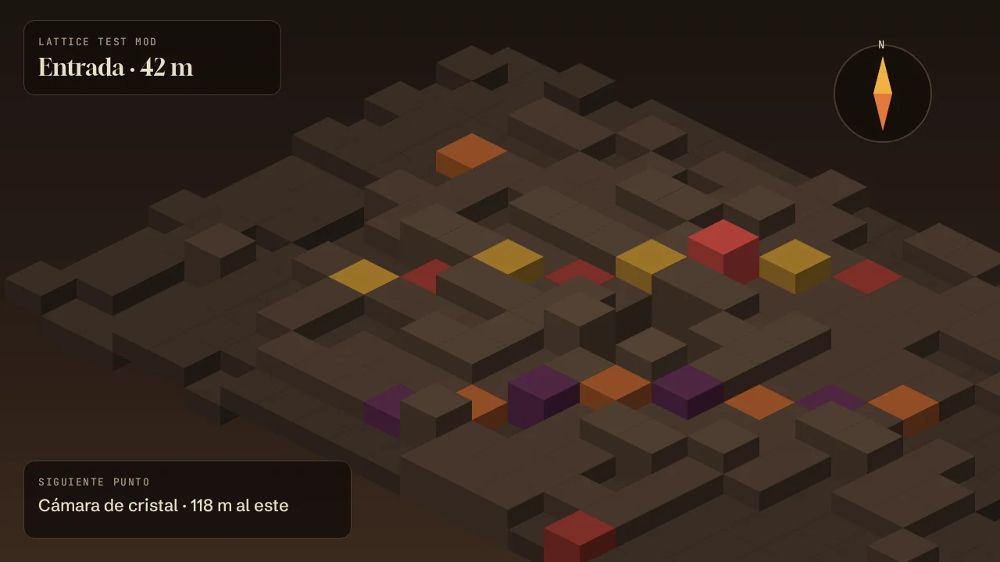

# Lattice Test Mod

Un mod que **no hace nada**. Existe para probar el verificador y las páginas de [Lattice](https://github.com/ultimaibrahim/lattice): cómo se lee un README, una galería y las notas de cada versión.

> Las imágenes de `images/` son ilustraciones de muestra generadas para esta prueba. No muestran el juego y no contienen recursos suyos.



## Qué hace

- Nada. Solo lleva los datos que Lattice lee de un mod: id, nombre, versión y autor.
- No usa la red, no escribe archivos y no lanza procesos.
- Por eso su nivel es **Reproducible**: el archivo se compila en GitHub Actions con una attestation.

## Instalar

1. Descarga `LatticeTestMod-<versión>.zip` desde la última release.
2. Comprueba el hash con `sha256sum` contra el que muestra Lattice.
3. Instálalo con `./aether add LatticeTestMod-<versión>.zip`.

```bash
sha256sum LatticeTestMod-v1.1.1.zip
./aether add LatticeTestMod-v1.1.1.zip
```

## Quitar

Borra `LatticeTestMod.dll` de la carpeta de mods. No deja ningún otro archivo.

## Lo que prueba esta página

| Elemento | Dónde se ve |
| :--- | :--- |
| Descripción | Este README, con títulos, listas, tablas, citas, código e imágenes de `images/` |
| Galería | La pestaña **Galería**, con visor |
| Cambios | Las notas de cada release |
| Personalización | `lattice.json`: color, banner, icono, etiquetas y enlaces |

---

Licencia MIT. Hecho con cuidado y sin ninguna utilidad práctica.
